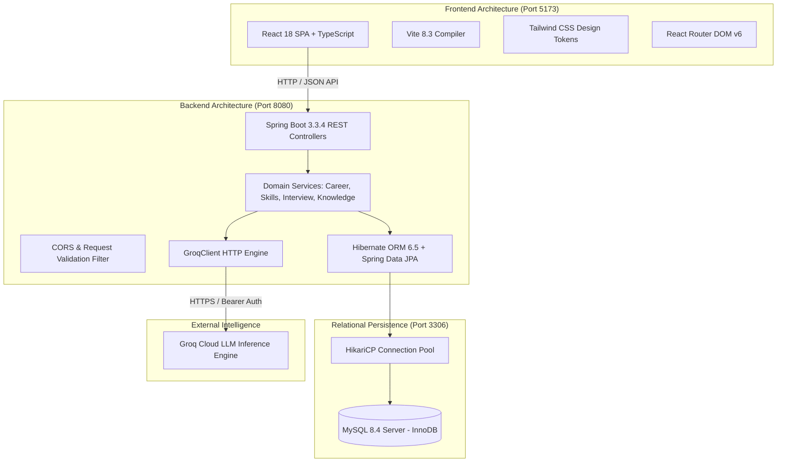
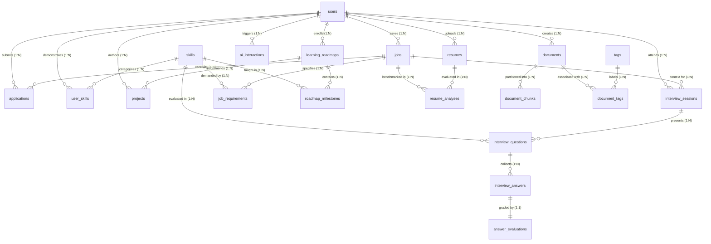

# UDAAN (उड़ान) — AI-Powered Relational Career Intelligence Platform

> **A Comprehensive Enterprise RDBMS & Modern Full-Stack System for Intelligent Career Alignment, Skill Mastery Roadmaps, Dynamic Mock Interviews, and Grounded Knowledge Retrieval.**

[](https://www.mysql.com/)
[](https://openjdk.org/)
[](https://spring.io/projects/spring-boot)
[](https://react.dev/)
[](https://www.typescriptlang.org/)
[](https://groq.com/)

---

## 1. Executive Summary & Project Purpose

**UDAAN (उड़ान)** is an advanced, production-grade career intelligence ecosystem engineered specifically for academic RDBMS evaluation and modern SaaS deployment. It transforms traditional, unstructured career navigation into a deterministic, relational, and AI-grounded decision engine.

Unlike generic dashboards that rely on hardcoded mock strings or disconnected client-side state, UDAAN is underpinned by a **20-table third-normal-form (3NF) relational database schema in MySQL 8.4**, a **Spring Boot 3 multi-tiered backend implementing strict Object-Oriented Design (OOP) principles**, and a **React 18 TypeScript frontend** styled with custom design tokens. Real-time evaluations are performed using **Groq Cloud LLM inference**, fully integrated with relational fallback strategies and database audit trails.

---

## 2. Complete Technology Stack



| Layer | Technology | Version | Key Responsibility in Architecture |
|---|---|---|---|
| **Database Engine** | **MySQL Server (InnoDB)** | **8.4 LTS** | 20 normalized tables, ACID transactions, Foreign Key constraints, B-Tree & Full-Text indexes, JSON data types. |
| **Connection Pooling** | **HikariCP** | **5.1.0** | High-performance JDBC connection management, leak detection, and transaction boundary execution. |
| **Backend Framework** | **Spring Boot** | **3.3.4** | RESTful routing, Dependency Injection, `@Transactional` orchestration, Global Exception Handling. |
| **Persistence / ORM** | **Hibernate ORM / Spring Data JPA** | **6.5.3** | Object-Relational Mapping, entity relationship cascades, JPQL repository queries, Schema validation. |
| **Programming Language** | **Java (OpenJDK)** | **21 LTS** | Core backend logic utilizing OOP concepts, Record DTOs, Pattern Matching, Stream API, and strict type safety. |
| **Frontend Framework** | **React** | **18.3.1** | Component-driven Single Page Application with hook-based state synchronization and optimistic updates. |
| **Language & Typings** | **TypeScript** | **5.5.3** | Strict client-side typing mirroring backend JPA entity contracts and API response envelopes. |
| **Styling & Design System** | **Tailwind CSS (Vanilla-styled)** | **3.4.14** | Curated Indian-inspired SaaS palette: Forest Green (`#315C46`), Warm Ivory (`#F8F7F3`), Saffron (`#C58A43`). |
| **Build & Tooling** | **Vite & Apache Maven** | **Vite 8 / Maven 3.9** | Sub-second frontend HMR and reliable multi-phase backend compilation and packaging. |
| **AI Inference** | **Groq Cloud API** | **SDK v1 / REST** | Sub-second generative rubric evaluation, personalized roadmaps, and grounded resume-job alignment. |

---

## 3. Comprehensive Entity-Relationship Diagram (ERD)

The relational schema consists of **20 interconnected entities** organized into 5 core modules:
1. **User & Identity Core** (`users`, `skills`, `user_skills`)
2. **Career & Alignment Intelligence** (`resumes`, `jobs`, `job_requirements`, `resume_analyses`, `applications`)
3. **Skill & Roadmap Mastery** (`learning_roadmaps`, `roadmap_milestones`, `projects`)
4. **Mock Interview Intelligence** (`interview_sessions`, `interview_questions`, `interview_answers`, `answer_evaluations`)
5. **Knowledge Management & Audit** (`documents`, `document_chunks`, `tags`, `document_tags`, `ai_interactions`)



---

## 4. Complete 20-Entity Relational Schema Dictionary

Every table is declared with **InnoDB storage engine**, explicit primary keys, foreign key constraints with cascade behaviors, and fine-tuned indexing.

### Entity 1: `users`
*Central candidate profile, authentication credential, and career baseline target role.*
- **Primary Key:** `id` (`BIGINT AUTO_INCREMENT`)
- **Foreign Keys:** None
- **Attributes:**
  - `name`: `VARCHAR(150) NOT NULL` — Candidate full legal name.
  - `email`: `VARCHAR(255) NOT NULL UNIQUE` — Unique login email address.
  - `password_hash`: `VARCHAR(255) NULL` — Salted bcrypt/argon password credential.
  - `target_role`: `VARCHAR(150) NOT NULL DEFAULT 'Full Stack Developer'` — Active desired career track.
  - `education`: `VARCHAR(255) NULL` — Degree, university, or academic credential.
  - `experience_summary`: `TEXT NULL` — Candidate career background and professional summary.
  - `created_at`: `TIMESTAMP DEFAULT CURRENT_TIMESTAMP`
  - `updated_at`: `TIMESTAMP DEFAULT CURRENT_TIMESTAMP ON UPDATE CURRENT_TIMESTAMP`
- **Indexes:** `idx_users_email (email)`, `idx_users_target_role (target_role)`

---

### Entity 2: `skills`
*Canonical master skill dictionary categorized across technical, architectural, and behavioural domains.*
- **Primary Key:** `id` (`BIGINT AUTO_INCREMENT`)
- **Foreign Keys:** None
- **Attributes:**
  - `name`: `VARCHAR(100) NOT NULL UNIQUE` — Canonical skill name (e.g. `React`, `Spring Boot`, `MySQL`).
  - `category`: `VARCHAR(80) NOT NULL DEFAULT 'General'` — Domain grouping (`Frontend`, `Backend`, `Database`, `DevOps`).
  - `description`: `VARCHAR(500) NULL` — Competency scope definition.
  - `created_at`: `TIMESTAMP DEFAULT CURRENT_TIMESTAMP`
- **Indexes:** `idx_skills_name (name)`, `idx_skills_category (category)`

---

### Entity 3: `user_skills`
*Resolves the Many-to-Many association between `users` and `skills` with verified evidence and proficiency levels.*
- **Primary Key:** `id` (`BIGINT AUTO_INCREMENT`)
- **Foreign Keys:**
  - `user_id` $\rightarrow$ `users(id)` (`ON DELETE CASCADE`)
  - `skill_id` $\rightarrow$ `skills(id)` (`ON DELETE RESTRICT`)
- **Attributes:**
  - `proficiency_level`: `ENUM('BEGINNER', 'DEVELOPING', 'INTERMEDIATE', 'ADVANCED') NOT NULL DEFAULT 'BEGINNER'`
  - `evidence_source`: `ENUM('RESUME', 'PROJECT', 'INTERVIEW', 'MANUAL_DECLARATION') NOT NULL`
  - `evidence_description`: `TEXT NULL` — Contextual proof of proficiency.
  - `confidence_level`: `DECIMAL(3,2) DEFAULT 0.50` — Confidence probability metric (0.00 to 1.00).
  - `assessed_at`: `TIMESTAMP DEFAULT CURRENT_TIMESTAMP`
- **Constraints & Indexes:** `UNIQUE KEY uq_user_skill (user_id, skill_id)`, `idx_user_skills_user`, `idx_user_skills_skill`, `idx_user_skills_proficiency`

---

### Entity 4: `resumes`
*Version-controlled candidate resumes holding raw extracted text.*
- **Primary Key:** `id` (`BIGINT AUTO_INCREMENT`)
- **Foreign Keys:**
  - `user_id` $\rightarrow$ `users(id)` (`ON DELETE CASCADE`)
- **Attributes:**
  - `title`: `VARCHAR(200) NOT NULL DEFAULT 'Primary Resume'`
  - `raw_text`: `LONGTEXT NOT NULL` — Complete resume text parsed for skill extraction and alignment.
  - `version_number`: `INT NOT NULL DEFAULT 1` — Monotonically increasing revision counter.
  - `is_active`: `BOOLEAN NOT NULL DEFAULT TRUE` — Flag indicating current primary resume.
  - `created_at`: `TIMESTAMP DEFAULT CURRENT_TIMESTAMP`
  - `updated_at`: `TIMESTAMP DEFAULT CURRENT_TIMESTAMP ON UPDATE CURRENT_TIMESTAMP`
- **Indexes:** `idx_resumes_user (user_id)`, `idx_resumes_active (user_id, is_active)`

---

### Entity 5: `jobs`
*Target job opportunities and company postings saved by the candidate.*
- **Primary Key:** `id` (`BIGINT AUTO_INCREMENT`)
- **Foreign Keys:**
  - `user_id` $\rightarrow$ `users(id)` (`ON DELETE CASCADE`)
- **Attributes:**
  - `job_title`: `VARCHAR(200) NOT NULL` — Target position title (e.g. `Full Stack Developer`).
  - `company_name`: `VARCHAR(150) NOT NULL` — Hiring company (e.g. `Zepto`, `PhonePe`).
  - `description_text`: `TEXT NOT NULL` — Full job description and requirements.
  - `location`: `VARCHAR(150) DEFAULT 'Remote'`
  - `employment_type`: `VARCHAR(50) DEFAULT 'Full-time'`
  - `created_at`: `TIMESTAMP DEFAULT CURRENT_TIMESTAMP`
  - `updated_at`: `TIMESTAMP DEFAULT CURRENT_TIMESTAMP ON UPDATE CURRENT_TIMESTAMP`
- **Indexes:** `idx_jobs_user (user_id)`, `idx_jobs_company (company_name)`

---

### Entity 6: `job_requirements`
*Normalized atomic requirements extracted from job postings with importance weights.*
- **Primary Key:** `id` (`BIGINT AUTO_INCREMENT`)
- **Foreign Keys:**
  - `job_id` $\rightarrow$ `jobs(id)` (`ON DELETE CASCADE`)
  - `skill_id` $\rightarrow$ `skills(id)` (`ON DELETE SET NULL`)
- **Attributes:**
  - `requirement_text`: `VARCHAR(500) NOT NULL` — Exact requirement specification.
  - `is_mandatory`: `BOOLEAN NOT NULL DEFAULT TRUE`
  - `weight`: `INT NOT NULL DEFAULT 1` — Importance weight (1 to 5) utilized in deterministic scoring.
  - `created_at`: `TIMESTAMP DEFAULT CURRENT_TIMESTAMP`
- **Indexes:** `idx_job_reqs_job (job_id)`, `idx_job_reqs_skill (skill_id)`

---

### Entity 7: `resume_analyses`
*Compatibility evaluation records storing match percentages, matching/missing skills, and cover letters.*
- **Primary Key:** `id` (`BIGINT AUTO_INCREMENT`)
- **Foreign Keys:**
  - `resume_id` $\rightarrow$ `resumes(id)` (`ON DELETE CASCADE`)
  - `job_id` $\rightarrow$ `jobs(id)` (`ON DELETE CASCADE`)
- **Attributes:**
  - `compatibility_score`: `DECIMAL(5,2) NOT NULL` — Normalized match score (0.00% to 100.00%).
  - `matching_skills`: `JSON NULL` — Serialized array of demonstrated candidate skills.
  - `missing_skills`: `JSON NULL` — Serialized array of priority skill gaps.
  - `recommendations`: `TEXT NULL` — 3 targeted, quantified resume bullet improvements.
  - `cover_letter_draft`: `TEXT NULL` — Tailored, personalized cover letter draft.
  - `created_at`: `TIMESTAMP DEFAULT CURRENT_TIMESTAMP`
- **Indexes:** `idx_analyses_resume (resume_id)`, `idx_analyses_job (job_id)`, `idx_analyses_score (compatibility_score)`

---

### Entity 8: `applications`
*Job application pipeline tracker managing status transitions across the candidate lifecycle.*
- **Primary Key:** `id` (`BIGINT AUTO_INCREMENT`)
- **Foreign Keys:**
  - `user_id` $\rightarrow$ `users(id)` (`ON DELETE CASCADE`)
  - `job_id` $\rightarrow$ `jobs(id)` (`ON DELETE CASCADE`)
- **Attributes:**
  - `status`: `ENUM('SAVED', 'APPLIED', 'ASSESSMENT', 'INTERVIEWING', 'OFFERED', 'REJECTED', 'WITHDRAWN') NOT NULL DEFAULT 'SAVED'`
  - `applied_date`: `DATE NULL`
  - `notes`: `TEXT NULL` — Candidate interview logs and recruiter feedback notes.
  - `salary_offered`: `VARCHAR(100) NULL`
  - `created_at`: `TIMESTAMP DEFAULT CURRENT_TIMESTAMP`
  - `updated_at`: `TIMESTAMP DEFAULT CURRENT_TIMESTAMP ON UPDATE CURRENT_TIMESTAMP`
- **Indexes:** `idx_apps_user (user_id)`, `idx_apps_status (user_id, status)`

---

### Entity 9: `learning_roadmaps`
*Structured, role-tailored study curricula designed to bridge identified candidate skill gaps.*
- **Primary Key:** `id` (`BIGINT AUTO_INCREMENT`)
- **Foreign Keys:**
  - `user_id` $\rightarrow$ `users(id)` (`ON DELETE CASCADE`)
- **Attributes:**
  - `target_role`: `VARCHAR(150) NOT NULL` — Track role (e.g. `Full Stack Developer`).
  - `title`: `VARCHAR(200) NOT NULL` — Curriculum title.
  - `description`: `TEXT NULL` — Scope of learning objectives.
  - `status`: `ENUM('ACTIVE', 'COMPLETED', 'ARCHIVED') NOT NULL DEFAULT 'ACTIVE'`
  - `created_at`: `TIMESTAMP DEFAULT CURRENT_TIMESTAMP`
  - `updated_at`: `TIMESTAMP DEFAULT CURRENT_TIMESTAMP ON UPDATE CURRENT_TIMESTAMP`
- **Indexes:** `idx_roadmaps_user (user_id)`, `idx_roadmaps_status (user_id, status)`

---

### Entity 10: `roadmap_milestones`
*Ordered learning steps with estimated hours, theoretical explanations, and capstone tasks.*
- **Primary Key:** `id` (`BIGINT AUTO_INCREMENT`)
- **Foreign Keys:**
  - `roadmap_id` $\rightarrow$ `learning_roadmaps(id)` (`ON DELETE CASCADE`)
  - `skill_id` $\rightarrow$ `skills(id)` (`ON DELETE SET NULL`)
- **Attributes:**
  - `title`: `VARCHAR(255) NOT NULL` — Milestone topic.
  - `concept_explanation`: `TEXT NULL` — Architectural explanation of underlying technology.
  - `step_order`: `INT NOT NULL DEFAULT 1` — Sequential order in curriculum.
  - `estimated_hours`: `INT NOT NULL DEFAULT 5` — Estimated hours to complete.
  - `status`: `ENUM('NOT_STARTED', 'IN_PROGRESS', 'COMPLETED') NOT NULL DEFAULT 'NOT_STARTED'`
  - `practice_task`: `TEXT NULL` — Hands-on capstone programming exercise.
  - `completed_at`: `TIMESTAMP NULL`
  - `created_at`: `TIMESTAMP DEFAULT CURRENT_TIMESTAMP`
- **Indexes:** `idx_milestones_roadmap (roadmap_id)`, `idx_milestones_order (roadmap_id, step_order)`, `idx_milestones_status (roadmap_id, status)`

---

### Entity 11: `projects`
*Practical, portfolio-grade capstone projects demonstrating skill mastery.*
- **Primary Key:** `id` (`BIGINT AUTO_INCREMENT`)
- **Foreign Keys:**
  - `user_id` $\rightarrow$ `users(id)` (`ON DELETE CASCADE`)
  - `roadmap_id` $\rightarrow$ `learning_roadmaps(id)` (`ON DELETE SET NULL`)
- **Attributes:**
  - `title`: `VARCHAR(200) NOT NULL` — Project title.
  - `description`: `TEXT NOT NULL` — Architectural requirements and deliverables.
  - `technologies`: `VARCHAR(300) NOT NULL` — Tech stack specification.
  - `status`: `ENUM('PLANNED', 'IN_PROGRESS', 'COMPLETED') NOT NULL DEFAULT 'PLANNED'`
  - `github_url`: `VARCHAR(255) NULL` — Public repository verification link.
  - `learning_outcomes`: `TEXT NULL` — Demonstrable competencies acquired.
  - `created_at`: `TIMESTAMP DEFAULT CURRENT_TIMESTAMP`
  - `updated_at`: `TIMESTAMP DEFAULT CURRENT_TIMESTAMP ON UPDATE CURRENT_TIMESTAMP`
- **Indexes:** `idx_projects_user (user_id)`, `idx_projects_status (user_id, status)`

---

### Entity 12: `interview_sessions`
*Mock interview configuration, evaluation category, and aggregate session scoring.*
- **Primary Key:** `id` (`BIGINT AUTO_INCREMENT`)
- **Foreign Keys:**
  - `user_id` $\rightarrow$ `users(id)` (`ON DELETE CASCADE`)
  - `job_id` $\rightarrow$ `jobs(id)` (`ON DELETE SET NULL`)
- **Attributes:**
  - `category`: `ENUM('TECHNICAL', 'CONCEPTUAL', 'BEHAVIORAL', 'MIXED') NOT NULL DEFAULT 'TECHNICAL'`
  - `difficulty`: `ENUM('BEGINNER', 'INTERMEDIATE', 'ADVANCED') NOT NULL DEFAULT 'INTERMEDIATE'`
  - `status`: `ENUM('IN_PROGRESS', 'COMPLETED', 'ABANDONED') NOT NULL DEFAULT 'IN_PROGRESS'`
  - `overall_score`: `DECIMAL(5,2) NULL` — Aggregate session score calculated in Java (0-100).
  - `summary_feedback`: `TEXT NULL` — Holistic performance review and revision guidance.
  - `created_at`: `TIMESTAMP DEFAULT CURRENT_TIMESTAMP`
  - `completed_at`: `TIMESTAMP NULL`
- **Indexes:** `idx_interviews_user (user_id)`, `idx_interviews_status (user_id, status)`

---

### Entity 13: `interview_questions`
*Dynamic questions generated per interview session tailored to the candidate's target role.*
- **Primary Key:** `id` (`BIGINT AUTO_INCREMENT`)
- **Foreign Keys:**
  - `session_id` $\rightarrow$ `interview_sessions(id)` (`ON DELETE CASCADE`)
  - `skill_id` $\rightarrow$ `skills(id)` (`ON DELETE SET NULL`)
- **Attributes:**
  - `question_text`: `TEXT NOT NULL` — Technical scenario, coding problem, or system design prompt.
  - `question_type`: `VARCHAR(80) NOT NULL DEFAULT 'TECHNICAL'`
  - `expected_rubric`: `TEXT NULL` — Grading criteria and expected trade-off analysis.
  - `sequence_order`: `INT NOT NULL DEFAULT 1` — Sequential order in the session.
  - `created_at`: `TIMESTAMP DEFAULT CURRENT_TIMESTAMP`
- **Indexes:** `idx_questions_session (session_id)`, `idx_questions_order (session_id, sequence_order)`

---

### Entity 14: `interview_answers`
*Candidate-submitted response transcripts recorded for asynchronous evaluation.*
- **Primary Key:** `id` (`BIGINT AUTO_INCREMENT`)
- **Foreign Keys:**
  - `question_id` $\rightarrow$ `interview_questions(id)` (`ON DELETE CASCADE`)
- **Attributes:**
  - `user_answer`: `TEXT NOT NULL` — Candidate's typed response transcript.
  - `submitted_at`: `TIMESTAMP DEFAULT CURRENT_TIMESTAMP`
- **Indexes:** `idx_answers_question (question_id)`

---

### Entity 15: `answer_evaluations`
*Multi-dimensional rubric evaluations, strengths, weaknesses, and benchmark ideal answers.*
- **Primary Key:** `id` (`BIGINT AUTO_INCREMENT`)
- **Foreign Keys:**
  - `answer_id` $\rightarrow$ `interview_answers(id)` (`ON DELETE CASCADE`)
- **Attributes:**
  - `score`: `INT NOT NULL` — Multi-dimensional rubric score (0 to 100).
  - `strengths`: `TEXT NULL` — Technical competencies demonstrated.
  - `weaknesses`: `TEXT NULL` — Architectural gaps, missing trade-offs, or unhandled edge cases.
  - `improvement_tips`: `TEXT NULL` — Concrete advice for improving technical depth.
  - `ideal_answer`: `TEXT NULL` — Staff-level benchmark answer for candidate review.
  - `concepts_to_revise`: `VARCHAR(500) NULL` — Specific technologies to study.
  - `created_at`: `TIMESTAMP DEFAULT CURRENT_TIMESTAMP`
- **Indexes:** `idx_evals_answer (answer_id)`, `idx_evals_score (score)`

---

### Entity 16: `documents`
*Candidate technical study notes, architecture cheat sheets, and interview prep guides.*
- **Primary Key:** `id` (`BIGINT AUTO_INCREMENT`)
- **Foreign Keys:**
  - `user_id` $\rightarrow$ `users(id)` (`ON DELETE CASCADE`)
- **Attributes:**
  - `title`: `VARCHAR(255) NOT NULL` — Note title.
  - `content`: `LONGTEXT NOT NULL` — Full Markdown body of the knowledge asset.
  - `summary`: `TEXT NULL` — Concise abstract.
  - `resource_url`: `VARCHAR(500) NULL` — External reference link.
  - `created_at`: `TIMESTAMP DEFAULT CURRENT_TIMESTAMP`
  - `updated_at`: `TIMESTAMP DEFAULT CURRENT_TIMESTAMP ON UPDATE CURRENT_TIMESTAMP`
- **Indexes:** `idx_docs_user (user_id)`, `FULLTEXT idx_docs_content (title, content)`

---

### Entity 17: `document_chunks`
*Searchable partitions of documents for localized full-text retrieval and Grounded RAG.*
- **Primary Key:** `id` (`BIGINT AUTO_INCREMENT`)
- **Foreign Keys:**
  - `document_id` $\rightarrow$ `documents(id)` (`ON DELETE CASCADE`)
- **Attributes:**
  - `chunk_index`: `INT NOT NULL DEFAULT 0` — Segment sequence index.
  - `content_chunk`: `TEXT NOT NULL` — Discrete paragraph or section text.
  - `created_at`: `TIMESTAMP DEFAULT CURRENT_TIMESTAMP`
- **Indexes:** `idx_chunks_document (document_id)`, `FULLTEXT idx_chunks_content (content_chunk)`

---

### Entity 18: `tags`
*Categorical labels for indexing and filtering knowledge articles.*
- **Primary Key:** `id` (`BIGINT AUTO_INCREMENT`)
- **Foreign Keys:** None
- **Attributes:**
  - `name`: `VARCHAR(80) NOT NULL UNIQUE` — Tag name (e.g. `MySQL`, `Spring Boot`, `FullStack`).
  - `created_at`: `TIMESTAMP DEFAULT CURRENT_TIMESTAMP`
- **Indexes:** `idx_tags_name (name)`

---

### Entity 19: `document_tags`
*Resolves the Many-to-Many association between `documents` and `tags`.*
- **Primary Key:** `id` (`BIGINT AUTO_INCREMENT`)
- **Foreign Keys:**
  - `document_id` $\rightarrow$ `documents(id)` (`ON DELETE CASCADE`)
  - `tag_id` $\rightarrow$ `tags(id)` (`ON DELETE CASCADE`)
- **Attributes:**
  - None (pure associative entity)
- **Constraints & Indexes:** `UNIQUE KEY uq_document_tag (document_id, tag_id)`, `idx_doc_tags_doc`, `idx_doc_tags_tag`

---

### Entity 20: `ai_interactions`
*Auditing and latency tracking for all Groq LLM invocations across modules.*
- **Primary Key:** `id` (`BIGINT AUTO_INCREMENT`)
- **Foreign Keys:**
  - `user_id` $\rightarrow$ `users(id)` (`ON DELETE SET NULL`)
- **Attributes:**
  - `module`: `VARCHAR(50) NOT NULL` — Module invoking AI (`CAREER`, `SKILL`, `INTERVIEW`, `KNOWLEDGE`).
  - `operation_type`: `VARCHAR(100) NOT NULL` — Invocations (`RESUME_ANALYSIS`, `ROADMAP_GEN`, `QUESTION_GENERATION`).
  - `model_used`: `VARCHAR(80) NOT NULL` — Model identifier (`openai/gpt-oss-120b`, `llama-3.3-70b-versatile`).
  - `duration_ms`: `INT NOT NULL DEFAULT 0` — Round-trip inference latency in milliseconds.
  - `status_code`: `VARCHAR(20) NOT NULL DEFAULT 'SUCCESS'` — Status (`SUCCESS`, `FALLBACK`, `ERROR`).
  - `error_message`: `TEXT NULL`
  - `created_at`: `TIMESTAMP DEFAULT CURRENT_TIMESTAMP`
- **Indexes:** `idx_ai_user (user_id)`, `idx_ai_module (module)`, `idx_ai_created (created_at)`

---

## 5. Object-Oriented Programming (OOP) in the Java Backend

The backend is built with **Java 21** and **Spring Boot 3**, structured around core Object-Oriented principles:

### 1. Encapsulation
- **Data Hiding in Entities:** All 20 domain models (e.g., `User`, `Resume`, `InterviewSession`, `LearningRoadmap`) enforce `private` fields. State mutations occur solely through validated setters and business methods.
- **DTO Isolation:** Data Transfer Objects (e.g., `CareerDtos.AnalyzeRequest`, `InterviewDtos.EvaluationDto`) encapsulate payload structures, preventing accidental leakage of internal relational properties (such as `passwordHash` or internal foreign keys).
- **Type-Safe Serialization:** Enums (`InterviewCategory`, `ProficiencyLevel`, `ApplicationStatus`) encapsulate allowable domain states, eliminating invalid string values at the compile and JPA layer.

### 2. Inheritance & Hierarchy
- **JPA Repository Inheritance:** Every repository interface (e.g. `UserRepository`, `ResumeRepository`, `InterviewSessionRepository`) extends `JpaRepository<T, ID>`, inheriting CRUD operations, pagination (`PagingAndSortingRepository`), and dynamic query derivation (`PartTreeJpaQuery`).
- **Entity Identity & Lifecycle:** Entities inherit standard identity lifecycles through `@Entity` and `@Table` mappings, establishing clear parenthood in bidirectional relationships (e.g. `InterviewSession` $\leftrightarrow$ `InterviewQuestion`).
- **Unified API Enveloping:** `ApiResponse<T>` acts as a polymorphic, generic wrapper (`ApiResponse.ok(data)` / `ApiResponse.error(message)`) standardizing timestamp, success boolean, and data payloads across all controllers.

### 3. Polymorphism
- **Dynamic Scoring & Matching Algorithms:** In `CareerService`, compatibility scoring calculates weights dynamically depending on whether evidence originates from verified `UserSkill` entities, raw resume token extraction, or live Groq AI evaluation.
- **Category-Adaptive Question Generation:** In `InterviewService`, the session generation dynamically alters its AI system prompt, grading rubric, and default curriculum based on the runtime `InterviewCategory` (`TECHNICAL` vs `CONCEPTUAL` vs `BEHAVIORAL`).
- **Generic Data Binding:** Jackson `ObjectMapper` dynamically deserializes JSON arrays and objects across heterogeneous DTO structures using `TypeReference<List<String>>`.

### 4. Abstraction
- **Layered Service Architecture:** Clear separation between Controllers (HTTP REST transport), Services (transactional business logic), and Repositories (database persistence). Controllers remain agnostic to database queries or external Groq HTTP endpoints.
- **External API Decoupling (`GroqClient`):** The `GroqClient` component abstracts the complexities of HTTP request headers, Bearer tokens, JSON payload serialization, rate limiting, and fallback extraction behind a simple interface:
  ```java
  public String generateChatCompletion(String systemPrompt, String userPrompt, String module, String operationType, User user);
  ```
- **RAG-Lite Search Abstraction:** In `KnowledgeService`, full-text chunk retrieval and keyword matching are abstracted behind domain queries, separating low-level SQL `MATCH(...) AGAINST(...)` syntax from knowledge consumers.

---

## 6. End-to-End Product Flow

```mermaid
sequenceDiagram
    autonumber
    actor Candidate as Candidate (Browser)
    participant UI as React TypeScript SPA
    participant Controller as Spring Boot REST Controller
    participant Service as Domain Service Layer
    participant Groq as Groq Cloud AI Engine
    participant DB as MySQL 8.4 (InnoDB)

    Note over Candidate, DB: Module 1: Career Intelligence & Live Analysis
    Candidate->>UI: Input custom resume text & target job (Zepto / Full Stack)
    UI->>Controller: POST /api/career/analyze?userId=3 (JSON payload)
    Controller->>Service: analyzeResumeCompatibility(userId, AnalyzeRequest)
    Service->>DB: INSERT into resumes & jobs; SELECT user_skills
    Service->>Groq: Generate match breakdown, bullet fixes & cover letter
    Groq-->>Service: Structured JSON Response
    Service->>DB: INSERT into resume_analyses (score, JSON skills, advice)
    Service-->>Controller: AnalysisResponse DTO
    Controller-->>UI: 200 OK (Match Score: 78%, Missing Skills, Cover Letter)

    Note over Candidate, DB: Module 2: Skill Gap & Learning Roadmap
    Candidate->>UI: Request Roadmap for Full Stack Developer
    UI->>Controller: POST /api/roadmaps?userId=3
    Controller->>Service: generateRoadmap(userId, RoadmapRequest)
    Service->>DB: Query missing skills from job_requirements
    Service->>Groq: Generate 4 ordered milestones for Full Stack track
    Groq-->>Service: JSON Array (State Management, Redux, Zustand, CI/CD)
    Service->>DB: INSERT into learning_roadmaps & roadmap_milestones
    Service-->>UI: 200 OK (Render Timeline & Capstone Project)

    Note over Candidate, DB: Module 3: Role-Specific Mock Interview
    Candidate->>UI: Launch "System Architecture & Conceptual" Interview
    UI->>Controller: POST /api/interviews?userId=3 (Category: CONCEPTUAL)
    Controller->>Service: startInterviewSession(userId, CreateSessionRequest)
    Service->>Groq: Generate 3 full-stack architecture questions
    Groq-->>Service: 3 dynamic questions (caching, multi-tenant SaaS, DB schema)
    Service->>DB: INSERT into interview_sessions & interview_questions
    Service-->>UI: 200 OK (Display Question 1 of 3)
    Candidate->>UI: Types technical answer & clicks "Submit"
    UI->>Controller: POST /api/interviews/{sessionId}/answers
    Controller->>Service: submitAnswer(sessionId, SubmitAnswerRequest)
    Service->>Groq: Evaluate answer against expected rubric
    Groq-->>Service: JSON (Score: 85, Strengths, Weaknesses, Ideal Answer)
    Service->>DB: INSERT into interview_answers & answer_evaluations
    Service-->>UI: 200 OK (Render Multi-Dimensional Score Banner)
```

---

## 7. RDBMS Academic Demonstration Queries

The platform includes a dedicated [`database/queries.sql`](file:///c:/Users/Admin/Desktop/Udaan/Udaan/database/queries.sql) script demonstrating **10 advanced SQL operations** to satisfy rigorous academic database evaluation:

1. **Multi-Table `LEFT JOIN` with Window Functions (`ROW_NUMBER() OVER`):** Retrieves all saved jobs alongside application status and the latest resume match score.
2. **Correlated Subquery & Skill Gap Classification:** Evaluates candidate competency against job requirements using `CASE ... WHEN` to categorize `STRONG_MATCH`, `PARTIAL_MATCH`, and `CRITICAL_GAP`.
3. **Aggregations & Milestone Arithmetic (`GROUP BY` & `NULLIF`):** Calculates exact roadmap completion percentages and total curriculum hours.
4. **Interview Performance Aggregation (`HAVING` & `AVG`):** Filters question categories where candidate practice averages fall below benchmark thresholds.
5. **Full-Text Natural Language Search (`MATCH ... AGAINST`):** Performs indexed relevance ranking across partitioned document study notes.
6. **AI Token & Performance Audit (`SUM`, `AVG`, `MAX`):** Aggregates Groq inference latency and failure rates by module.
7. **ACID Transaction Simulation (`START TRANSACTION` / `COMMIT` / `ROLLBACK`):** Atomically updates candidate application statuses, records notes, and timestamps changes.
8. **Relational Database Views (`CREATE OR REPLACE VIEW`):** Provides a pre-aggregated executive dashboard summary view.
9. **Many-to-Many Bridge Traversal:** Queries all documents tagged with `#FullStack` via `document_tags`.
10. **Uncorrelated `NOT IN` Subquery:** Detects unaddressed critical skill gaps for curriculum recommendation.

---

## 8. Local Setup & Execution Guide

### Prerequisites
- **Java Development Kit (JDK):** Version 21 LTS
- **Node.js:** Version 18.x or 20.x (with `npm`)
- **MySQL Server:** Version 8.0 or 8.4
- **Groq API Key:** Active key from [GroqCloud Console](https://console.groq.com/)

### Step 1: Database Initialization
1. Ensure your MySQL server is running on `localhost:3306`.
2. Connect to MySQL and execute the setup scripts:
   ```powershell
   # 1. Initialize 20-table schema
   mysql -u root -p < database/schema.sql

   # 2. Seed realistic baseline data
   mysql -u root -p udaan_db < database/sample_data.sql
   ```

### Step 2: Configure Environment Variables
Create a `.env` file in the project root:
```env
# Groq AI Credentials
GROQ_API_KEY=gsk_your_actual_groq_api_key_here
GROQ_MODEL=openai/gpt-oss-120b

# MySQL Database
DB_HOST=localhost
DB_PORT=3306
DB_NAME=udaan_db
DB_USERNAME=root
DB_PASSWORD=your_mysql_password

# Port Configuration
SERVER_PORT=8080
VITE_API_BASE_URL=http://localhost:8080/api
```

### Step 3: Run the Backend (Spring Boot 3)
```powershell
cd backend
.\mvnw.cmd spring-boot:run
```
*The Spring Boot server will compile and start on `http://localhost:8080` with active profile `mysql`.*

### Step 4: Run the Frontend (React + Vite)
In a separate terminal:
```powershell
cd frontend
npm install
npm run dev
```
*The frontend development server will launch on `http://localhost:5173`.*

---

## 9. Verification & Live Demonstration Checklist

| Module | Verification Step | Expected Live Outcome |
|---|---|---|
| **Candidate Switching** | Open bottom-left switcher, select **Shaaz Adil** (ID #3). | Top bar and console update immediately to "Shaaz Adil · Full Stack Developer". |
| **Career Intelligence** | Navigate to `/career`, choose **"Live Custom Input & Paste"**, enter real resume text & Zepto job. | Groq AI analyzes live input, computes compatibility score, extracts matching skills, and drafts a customized cover letter. |
| **Skill Roadmaps** | Navigate to `/skills`, view Active Roadmap or click **"Re-generate via Groq AI"**. | Generates ordered Full Stack milestones (Client-side state, Redux, Zustand, CI/CD). |
| **Mock Interview** | Navigate to `/interviews`, select **"System Architecture & Conceptual"** for Full Stack Developer. | Generates 3 dynamic architecture questions (caching, REST APIs, database concurrency). Submitting answers returns rubric grading. |
| **Knowledge Library** | Navigate to `/knowledge`, filter notes by `#MySQL` or `#FullStack`. | Instant full-text search with tag filtering, Markdown rendering, and grounded AI QA. |

---

## 10. Contributors & License

- **Developer & Architect:** Shaaz Adil
- **Project Title:** UDAAN (उड़ान) — AI Career Intelligence Platform
- **Course Focus:** Relational Database Management Systems (RDBMS) / Full-Stack Enterprise Engineering
- **License:** MIT License. Built for academic evaluation, startup demonstrations, and portfolio showcase.
