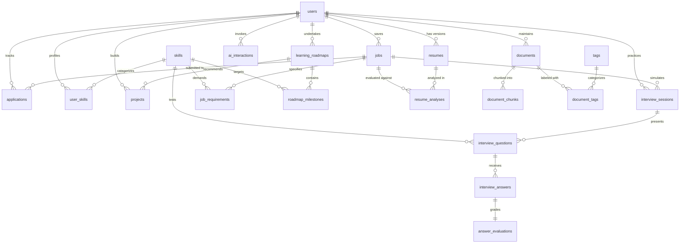

# Udaan AI — Database Architecture & ER Documentation

## Database Information
* **Database Name:** `udaan_db`
* **Target Engine:** MySQL 8.0+ (InnoDB)
* **Default Collation:** `utf8mb4_unicode_ci`
* **Schema File:** [`schema.sql`](./schema.sql)
* **Sample Data:** [`sample_data.sql`](./sample_data.sql)
* **Academic Demonstration Queries:** [`queries.sql`](./queries.sql)

---

## Entity Relationship Diagram (ERD)

---

## 20-Table Relational Schema Catalogue

| # | Table Name | Primary Key | Foreign Keys & Relationships | Description |
|---|---|---|---|---|
| 1 | `users` | `id` | - | Central user profile and career baseline target role |
| 2 | `skills` | `id` | Unique `name` | Canonical master skill dictionary |
| 3 | `user_skills` | `id` | `user_id` -> `users(id)`, `skill_id` -> `skills(id)` | Candidate proficiency levels with evidence tracking |
| 4 | `resumes` | `id` | `user_id` -> `users(id)` | Version-controlled candidate resumes with raw text |
| 5 | `jobs` | `id` | `user_id` -> `users(id)` | Target job listings saved by candidate |
| 6 | `job_requirements` | `id` | `job_id` -> `jobs(id)`, `skill_id` -> `skills(id)` | Normalized job requirements and importance weights |
| 7 | `resume_analyses` | `id` | `resume_id` -> `resumes(id)`, `job_id` -> `jobs(id)` | Match score, matching/missing skills, cover letters |
| 8 | `applications` | `id` | `user_id` -> `users(id)`, `job_id` -> `jobs(id)` | Pipeline status tracking (APPLIED, INTERVIEWING, etc.) |
| 9 | `learning_roadmaps`| `id` | `user_id` -> `users(id)` | Personalized study curriculums for identified gaps |
| 10| `roadmap_milestones`| `id` | `roadmap_id` -> `learning_roadmaps(id)` | Ordered milestone steps with practical exercises |
| 11| `projects` | `id` | `user_id` -> `users(id)`, `roadmap_id` -> `learning_roadmaps(id)` | Competency-demonstrating portfolio projects |
| 12| `interview_sessions`| `id` | `user_id` -> `users(id)`, `job_id` -> `jobs(id)` | Mock interview session configurations and grades |
| 13| `interview_questions`| `id` | `session_id` -> `interview_sessions(id)` | Dynamic questions generated for current session |
| 14| `interview_answers` | `id` | `question_id` -> `interview_questions(id)` | Candidate typed transcript submissions |
| 15| `answer_evaluations`| `id` | `answer_id` -> `interview_answers(id)` | Multi-dimensional rubric scores and feedback |
| 16| `documents` | `id` | `user_id` -> `users(id)` | Study notes, cheat sheets, interview prep guides |
| 17| `document_chunks` | `id` | `document_id` -> `documents(id)` | Granular chunks for localized search (RAG-Lite) |
| 18| `tags` | `id` | Unique `name` | Reusable categorical tags |
| 19| `document_tags` | `id` | `document_id` -> `documents(id)`, `tag_id` -> `tags(id)` | M:N association between documents and tags |
| 20| `ai_interactions` | `id` | `user_id` -> `users(id)` | Audit trail of Groq API calls, latency, and tokens |
